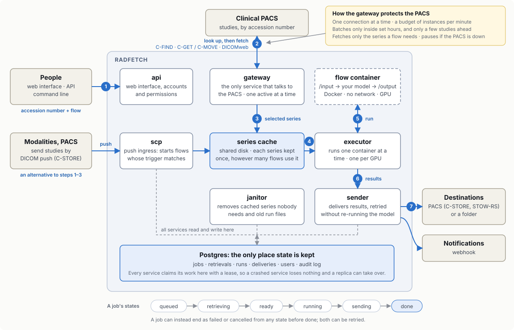

# RadFetch

Runs containerized workflows on studies pulled from a clinical PACS by accession
number, one-off or in batches, without overloading the PACS.



| Service | Role |
|---|---|
| `postgres` | The only state store: jobs, retrievals, runs, deliveries, audit events |
| `api` | Submit jobs and batches; pause, resume, cancel; status |
| `gateway` | The only process that talks to the PACS. Resolves accession numbers and retrieves series into the cache |
| `scp` | Push ingress: a storage SCP; received studies start every flow whose `trigger` matches |
| `executor-gpu`, `executor-cpu` | Run the flows' containers, one step at a time each: GPU executors take steps marked `gpu`, CPU executors the rest |
| `sender` | Delivers run output (C-STORE or directory), retried independently of inference |
| `janitor` | Evicts unused cached series and old run directories |

## Documentation

Full documentation is in [`docs/`](docs/README.md), published at https://mathiser.github.io/RadFetch/ once GitHub Pages is enabled:

- [Concepts](docs/concepts.md): how it works and how the PACS is protected
- [Tutorial](docs/tutorial.md): first jobs on your own machine with a fake PACS
- [Installation](docs/installation.md): checklist for a GPU host and a real PACS
- [Connecting a PACS](docs/pacs.md), [Writing flows](docs/flows.md), [Configuration reference](docs/configuration.md)
- [Administration](docs/administration.md), [Users and permissions](docs/users.md), [Single sign-on](docs/sso.md), [High availability](docs/high-availability.md), [Troubleshooting](docs/troubleshooting.md)
- [API](docs/api.md) and [command line](docs/cli.md) references, [Development](docs/development.md)

## Quick start (with a fake PACS)

```bash
cp .env.example .env
```

Edit `.env`: set `RADFETCH_HOST_DATA_DIR` to the absolute path of `./data`, and
clear `RADFETCH_BATCH_WINDOWS` so batches run during the day.

```bash
docker compose --profile dev up -d --build
```

Open http://localhost:8000, submit accession number `ACC0001` with the flow
`example`, and watch it run. The [Tutorial](docs/tutorial.md) continues from here.

## Features

- Pull by accession number, one-off or in batches with pause, resume, cancel and retry
- Push ingress: studies sent by C-STORE start flows whose trigger matches
- Retrieval by C-GET, C-MOVE or DICOMweb, fetching only the series a flow selects, each once
- PACS protection: single association, rate budget, batch windows, bounded preloading, disk watermarks, circuit breaker
- Flows of one or several containers, chained by mounting one step's output into the next; GPU and CPU executors share the work step by step, so independent steps run in parallel and the GPU is not held during CPU steps; run through Docker with read-only inputs, no network and optional GPU
- Delivery by C-STORE, STOW-RS or to a directory, retried independently of inference
- Web interface with dashboards, HTTP API, Prometheus metrics, webhook notifications
- User accounts with five roles, individually adjustable permissions and per-flow restrictions; audit log
- Single sign-on (OpenID Connect) with roles from directory groups; two-step sign-in with authenticator apps
- Redundant services with automatic takeover; example Docker Swarm stack
- Structured results: flows report arbitrary JSON, stored per job, searchable and exportable as CSV
- Traceability: per-run image digest, a manifest with every result, an audit trail per job
- TLS for DICOM connections; crash-safe by design, with Postgres as the only state store

## Status

Tested in CI against an in-memory PACS and a real Orthanc (C-GET, C-MOVE with and
without TLS, DICOMweb), with a full Compose smoke test. Not yet verified against a
vendor PACS or on a real GPU; see [Installation](docs/installation.md) for the trial plan.
