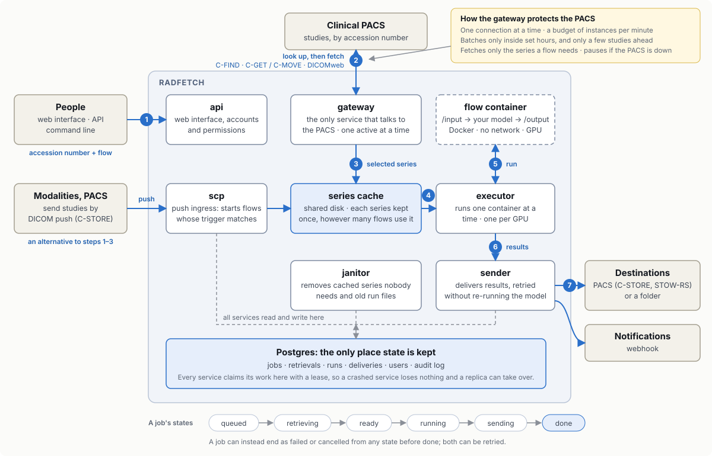

# RadFetch documentation

RadFetch runs containerized workflows on studies from a clinical PACS. It pulls
studies by accession number (one at a time or in batches) or receives them by
DICOM push, runs a container on them, and delivers the results, while keeping
the load on the PACS within limits you set.

## Start here

| If you want to | Read |
|---|---|
| Understand how it works | [Concepts](concepts.md) |
| Try it in ten minutes on your laptop | [Tutorial](tutorial.md) |
| Install it on a GPU host against a real PACS | [Installation](installation.md) |

## Setting up

- [Connecting a PACS](pacs.md): retrieve modes, AE titles, TLS, trying against Orthanc
- [Writing flows](flows.md): selecting series, the container contract, destinations, triggers
- [Configuration reference](configuration.md): every setting

## Running it

- [Administration](administration.md): notifications, monitoring, backup, retention, upgrades, GPUs
- [Users and permissions](users.md): roles, individual permissions, flow restrictions, tokens, audit log
- [Single sign-on and two-step sign-in](sso.md): OpenID Connect, roles from directory groups, authenticator apps
- [High availability](high-availability.md): redundant services, Docker Swarm, what is and is not covered
- [Troubleshooting](troubleshooting.md): what an error or symptom means and what to do
- [Upgrade notes](upgrading.md): changes that need something from you when upgrading
- [API reference](api.md) and [command line reference](cli.md)

## Working on RadFetch

- [Development](development.md): tests, CI, project layout
