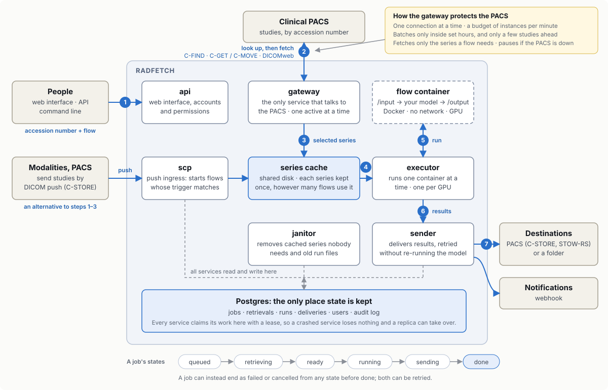

# Concepts

## The two ways in



The numbers in the diagram follow one pulled job: (1) someone submits an accession
number and a flow; (2) the gateway looks the study up in the PACS and (3) fetches
the selected series into the cache; (4) the executor takes the job and (5) runs the
flow's container on those series; (6) the results go to the sender, which (7)
delivers them.

- **Pull.** You give RadFetch an accession number and a flow. It looks the study up in the PACS, fetches only the series the flow asks for, and runs the flow.
- **Push.** A modality or PACS sends a study to RadFetch's storage SCP. Every flow that has a `trigger` matching the sender, and whose series rules match what arrived, is started.

Both paths end in the same place: series in the local cache and a job ready for the executor.

## Services

| Service | What it does | How many |
|---|---|---|
| `postgres` | The only state store: jobs, retrievals, runs, deliveries, audit events | 1 |
| `api` | HTTP API and web UI | 1 |
| `gateway` | The only process that talks to the PACS | 1 active (extra replicas stand by) |
| `scp` | Push ingress (storage SCP) | 0 or 1 |
| `executor-gpu` | Runs steps marked `gpu`, one at a time | 1 per GPU |
| `executor-cpu` | Runs every other step, one at a time each | as many as the host's CPU and memory allow |
| `sender` | Delivers results; retried independently of inference | 1 |
| `janitor` | Evicts unused cached series, removes old run files | 1 |

## Words used throughout

- **Flow**: a YAML file saying which series to use, which container image to run, and where results go. See [Writing flows](flows.md).
- **Job**: one flow on one accession number (or one pushed study).
- **One-off job**: a single job submitted for immediate attention. It goes ahead of batch work.
- **Batch**: a named list of accession numbers for one flow. Batches can be paused, resumed and cancelled as a whole.
- **Retrieval**: one series in the local cache. Several jobs can share one retrieval, so a series is fetched once however many flows use it.
- **Step**: one container in a flow. Most flows have one; a flow can chain several, each reading the output of earlier ones.
- **Run**: one execution of a step's container for a job. A job has several runs if its flow has several steps, or if one fails and is retried.
- **Delivery**: sending one run's output to one destination.

## Job states

```
queued ─> retrieving ─> ready ─> running ─> sending ─> done
   any state before done ─> failed | cancelled
```

| State | Meaning | Who moves it on |
|---|---|---|
| `queued` | Waiting for the gateway to look the study up in the PACS | gateway |
| `retrieving` | Study found; waiting for its series to be fetched | gateway |
| `ready` | All series are in the cache; no step has started yet | executor |
| `running` | At least one step has started. The job stays `running` between steps and while a step waits to be retried | executor |
| `sending` | The run succeeded; results are being delivered | sender |
| `done` | All deliveries succeeded | |
| `failed` | Gave up; the job's `error` says why. Can be retried | you |
| `cancelled` | Cancelled by a user. Can be retried | you |

Pushed jobs start at `ready`.

## How the PACS is protected

All of this is enforced by the gateway.

| Protection | What it does | Applies to one-off jobs |
|---|---|---|
| Single association | The gateway does one PACS operation at a time | yes |
| Selective retrieval | Only series a flow selects are fetched, and each only once | yes |
| Minimum interval | A pause between any two PACS operations | yes |
| Circuit breaker | After repeated PACS failures all traffic stops for a cooldown that doubles while failures continue | yes |
| Hard disk limit | No retrieval above 95% disk usage | yes |
| Rate budget | Caps average instances per minute | no |
| Batch window | Batch work only inside configured hours | no |
| Bounded preloading | Batch studies are fetched only a few ahead of the executors. Jobs queueing for the GPU after a CPU step count too | no |
| Disk watermark | Batch retrieval stops at 80% disk usage | no |

One-off jobs skip the last four so that an urgent request is not held up by a
running batch. They can never open a second association or push past an open
circuit breaker.

## Priorities

One-off jobs run first, then pushed jobs, then batch jobs. Priority applies both
when fetching and when an executor picks its next step, so an urgent job's steps
go ahead of the remaining steps of batch jobs. A running container is never
interrupted for a more urgent job.

## Crash safety

Workers claim work with a lease. If a worker dies, its lease expires and the work
becomes claimable again; nothing needs cleaning up. Executors claim one step at a
time: after an executor crash or restart, another executor of the same kind finds
the container that was running and waits for it instead of starting the step
again, and a job whose last step finished just as its executor died is completed
by another executor.
